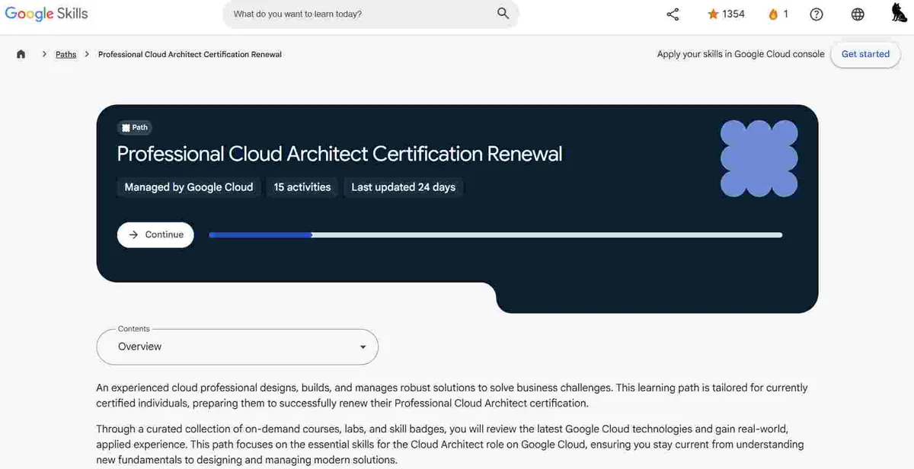
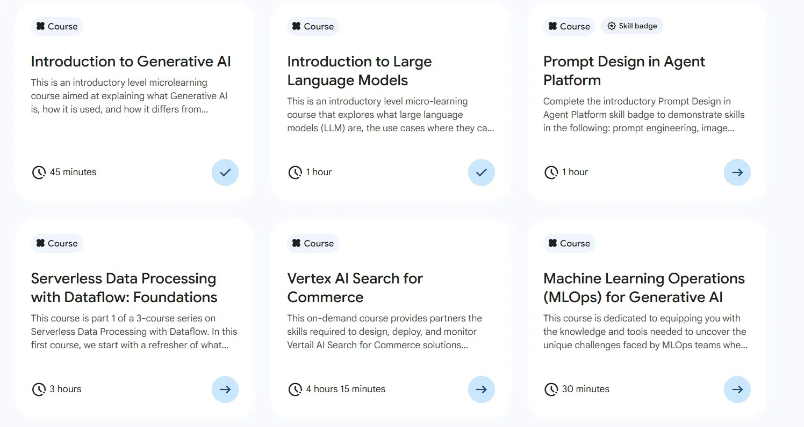

# Renewing My GCP Professional Cloud Architect Certification

My Google Cloud Platform certification just expired, so I started my renewal course — and I was so surprised to discover how much **AI and LLM-related content** it now contains. It honestly got me excited about what's coming next in cloud architecture.

<figure class="fig">
  
  <figcaption><b>Official badge</b> — The Professional Cloud Architect certification badge issued through Credly. Source: <a href="https://www.credly.com/org/google-cloud/badge/professional-cloud-architect-certification">Credly — Professional Cloud Architect Certification</a></figcaption>
</figure>

## What the Renewal Path Looks Like

The renewal path is managed by **Google Cloud**, contains **15 activities**, and was last updated **24 days ago**. It's tailored for currently certified professionals preparing to renew their Professional Cloud Architect certification.

Through a curated collection of on-demand courses, labs, and skill badges, the path reviews the latest Google Cloud technologies and gives you real-world, applied experience — from new fundamentals to designing and managing modern solutions.

## The Surprise: AI Is Everywhere

What impressed me most is how deeply AI and LLM topics are woven into the curriculum. The cloud has evolved, and so has the role of a cloud architect — staying current now means understanding AI, not just infrastructure.

> **Note:** The renewal exam is available to individuals within **60 days before** and **30 days after** their certification expiration date.

Next step: finish the 15 activities, earn the renewed credential, and keep learning. #googlecloudcertified
