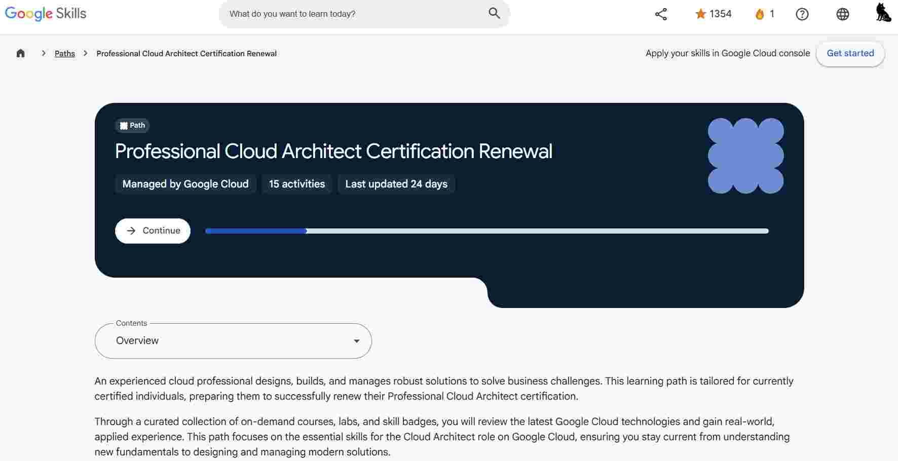
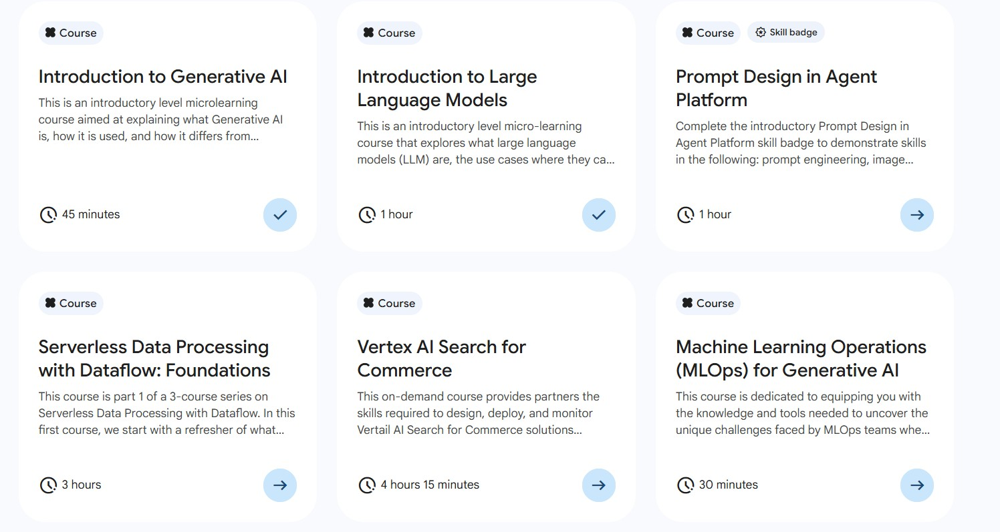

# 续证我的 Google Cloud Professional Cloud Architect 认证

我的 Google Cloud Platform 认证刚刚到期，于是开始上续证课程——我惊讶地发现，现在的课表里有这么多**AI 与 LLM 相关内容**。说实话，这让我对云架构接下来会发生什么感到兴奋。

## 续证路径是什么样的

这条续证路径由 **Google Cloud** 维护，包含 **15 个活动**，最后更新于 **24 天前**。它是为已持有认证、正准备续证 Professional Cloud Architect 的专业人士设计的。

通过一系列点播课程、动手实验与技能徽章，这条路径回顾了最新的 Google Cloud 技术，并提供真实场景的实践经验——从基础概念到设计与管理现代化解决方案。

## 惊喜：AI 无处不在

最让我印象深刻的是，AI 与 LLM 主题多么深入地织进课表之中。云已经演进，云架构师的角色也随之改变——保持与时俱进，现在意味着要理解 AI，而不只是基础设施。

> **注意：** 续证考试开放给认证到期日前 **60 天** 至到期日后 **30 天** 内的考生。

下一步：完成这 15 个活动、取得续证资格，然后继续学习。#googlecloudcertified
